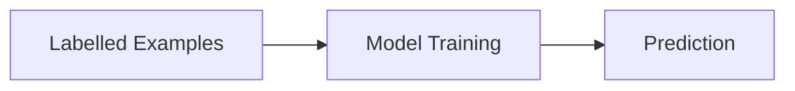
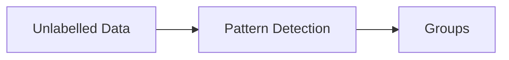
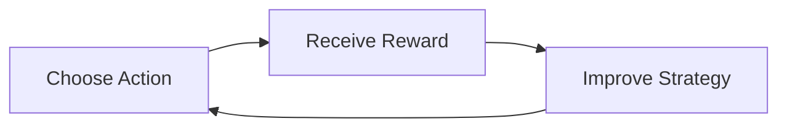
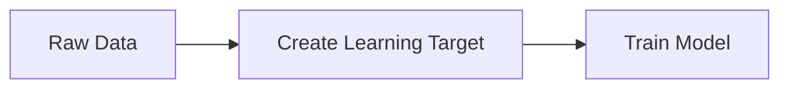

# Mission 3 — Understand the Main ML Approaches

## 1. Comparison Table

| Approach                 | How It Learns                                | Example                                      | Limitation                                          |
| ------------------------ | -------------------------------------------- | -------------------------------------------- | --------------------------------------------------- |
| Supervised Learning      | Learns from labelled examples                | Predicting whether a student passes or fails | Requires labelled data                              |
| Unsupervised Learning    | Finds patterns in unlabelled data            | Grouping songs by similar musical styles     | Patterns may be difficult to understand             |
| Reinforcement Learning   | Learns through rewards and penalties         | A robot learns to navigate around obstacles  | Training can take many attempts                     |
| Self-Supervised Learning | Creates learning targets from available data | Predicting a missing word in a sentence      | May not learn everything needed for a specific task |

## 2. Simple Diagrams

### Supervised Learning

### Unsupervised Learning

### Reinforcement Learning

### Self-Supervised Learning

## 3. When Are These Approaches Useful?

* **Supervised Learning:** When labelled examples are available to predict an outcome.
* **Unsupervised Learning:** When exploring data to discover hidden groups or patterns.
* **Reinforcement Learning:** When learning to make decisions through feedback from actions.
* **Self-Supervised Learning:** When large amounts of raw data are available to create training targets automatically.

**Key takeaway:** Each approach learns differently. The right choice depends on the available data, the problem, and the expected result.

## Sources

Refer to `sources.md` for Google’s Introduction to Machine Learning and IBM’s machine-learning overview.
