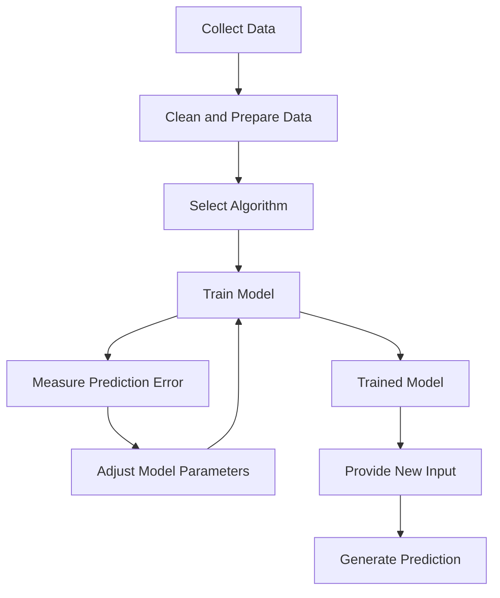
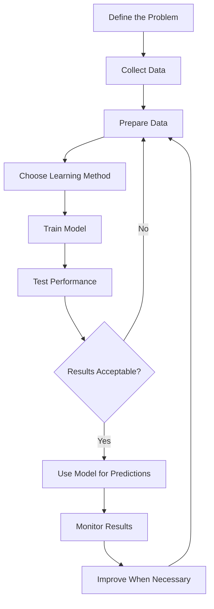

# Mission 5 — Understand the Anatomy of an ML Model

## 1. Basic Terms

| Term         | Simple Explanation                                                  |
| ------------ | ------------------------------------------------------------------- |
| Algorithm    | A method used to learn patterns from data                           |
| Model        | A trained system that produces predictions                          |
| Parameters   | Values learned by the model during training                         |
| Training     | Teaching a model using available data                               |
| Inference    | Using a trained model to process new data                           |
| Loss / Error | A measure of how different a prediction is from the expected answer |
| Optimisation | Improving the model by adjusting its learned values                 |

## 2. How an ML Model Works

**Explanation:** During training, the model learns from examples and adjusts its parameters to reduce errors. Once trained, it can process new inputs and generate predictions. Its performance should also be checked using separate test data.

## 3. Linear Regression Example

Linear regression is used to estimate numerical values.

For example, a model can learn how house prices relate to house size using previous sales data. When given the size of a new house, it estimates its price.

However, the estimate may be inaccurate if important factors, such as location or property condition, are not considered.

## 4. Machine Learning Lifecycle

The main stages are defining the problem, preparing data, training the model, evaluating its performance, and monitoring its results after deployment.

## 5. Key Takeaway

Training helps a model learn patterns from existing data, while inference uses the trained model to make predictions on new inputs. **A model's prediction is an estimate, so its accuracy and reliability must be evaluated before relying on it.**

## Sources

Refer to `sources.md` for Google ML Crash Course topics on model training, linear regression, and datasets.
